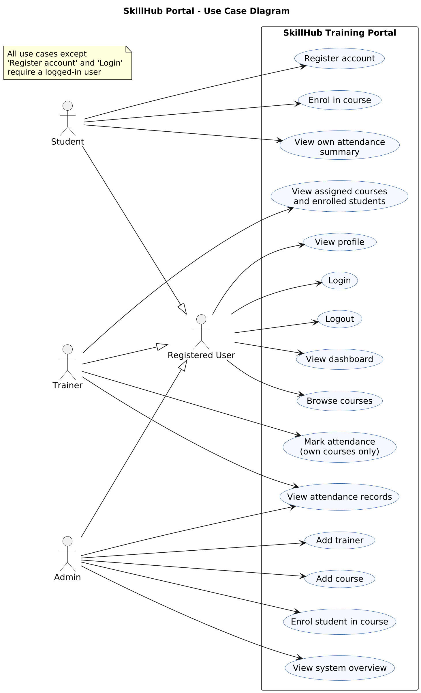
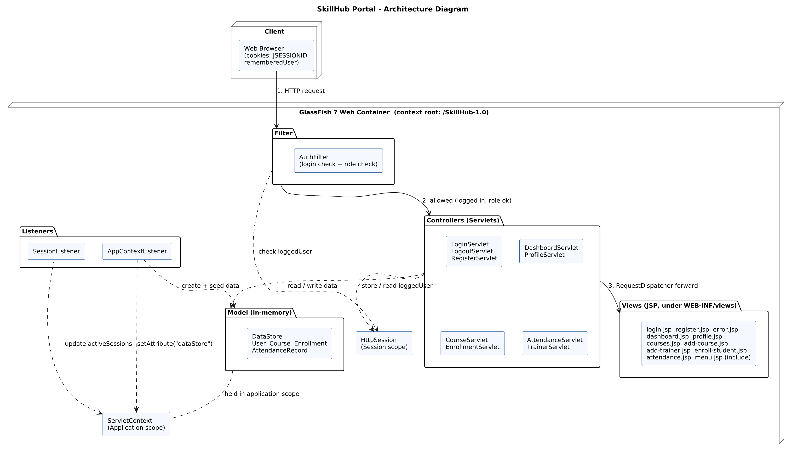
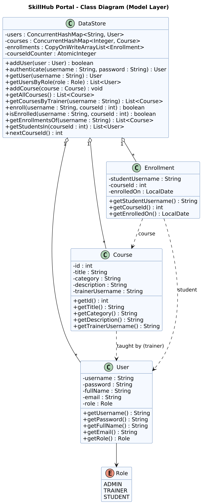

# COVER PAGE

**Project Title:** SkillHub Training Portal – A Java EE (Jakarta EE) Web Application

**Student Name:** [Your Full Name]

**Student ID:** [Your Student ID]

**Batch:** [Your Batch]

**Unit Code:** HF2J

**Unit Name:** Web Component Development I

**Assessment:** Web Application Development Project (Component A)

**Submission Date:** [DD Month YYYY]

---

# 1. Introduction

SkillHub Training Academy is a rapidly expanding professional training organisation that delivers technology, business and professional development programmes. Student registrations, course enrolments and trainer information are currently handled through manual administration processes. Management has decided to introduce a web-based training management portal to improve efficiency, automate learner services and give users secure online access to training information.

This report describes the analysis, design, development, deployment and testing of the **SkillHub Training Portal**, a Java EE web application built with Servlets, JavaServer Pages (JSP) and standard web container features (ServletContext, RequestDispatcher, Filters, Listeners and attribute scopes). The application is developed with Jakarta EE 10 (the current name of Java EE) and deployed as a WAR file on **GlassFish 7**.

As required by the scenario, the application does not use a database management system. All data is held in in-memory Java collections, and these collections are stored in the **Application scope** (`ServletContext`) when the application starts. Users log in through a form, are tracked with HTTP sessions and cookies, and see pages that depend on their role (Admin, Trainer or Student).

The application is available at **http://localhost:8080/SkillHub-1.0/** when deployed.

---

# 2. Requirements Analysis

## 2.1 Users (Actors)

| Actor | Description |
|---|---|
| **Student** | Registers an account, logs in, browses courses, enrols in courses and views their own profile and enrolments. |
| **Trainer** | Logs in and views the courses assigned to them and the students enrolled in those courses. The Trainer role is **view-only**; trainers cannot change data. |
| **Admin** | Logs in, adds new courses (and assigns a trainer to each), and views a system overview (number of users, courses, enrolments and active sessions). |

All three actors are "registered users" who share common functions (login, logout, dashboard, browse courses, profile), as shown in Figure 1.



*Figure 1 – Use Case Diagram of the SkillHub Training Portal*

## 2.2 Functional Requirements

| ID | Requirement |
|---|---|
| FR1 | Students can register a new account (username, password, full name, email). |
| FR2 | All users can log in with a username and password. |
| FR3 | The system tracks the logged-in user with a session and allows logout, which destroys the session. |
| FR4 | The login page can remember the last username using a cookie (optional "Remember my username" checkbox). |
| FR5 | The dashboard shows content according to the user's role (Student: own enrolments; Trainer: assigned courses and enrolled students; Admin: system overview). |
| FR6 | All logged-in users can view the list of available courses. |
| FR7 | Students can enrol in a course (a student cannot enrol twice in the same course). |
| FR8 | Admins can add a new course and assign a trainer to it. |
| FR9 | Users can view their profile details. |
| FR10 | Pages that require login, or a particular role, cannot be accessed without it. |
| FR11 | A friendly error page is displayed for errors such as 403, 404 and 500. |

## 2.3 Non-Functional Requirements

| ID | Requirement |
|---|---|
| NFR1 | **Usability:** simple, consistent navigation menu on every page. |
| NFR2 | **Security:** protected pages are only reachable by authenticated and authorised users. |
| NFR3 | **Maintainability:** clear separation of model, controller and view code (MVC). |
| NFR4 | **Portability:** packaged as a standard WAR that runs on a Jakarta EE 10 web container. |
| NFR5 | **Thread safety:** shared in-memory data uses thread-safe collections. |

## 2.4 Business Requirements

- **Automation:** replace manual registration and enrolment administration with an online portal.
- **Efficiency:** let students register and enrol themselves, reducing staff workload.
- **Access:** provide secure online access to training information.

## 2.5 Assumptions

| ID | Assumption |
|---|---|
| A1 | Data is held in memory only, so it is lost when the application or server restarts. This is acceptable for this prototype. |
| A2 | At startup a `ServletContextListener` loads sample data: one admin, two trainers, one student and four courses. |
| A3 | Passwords are stored and compared as plain text. This is acceptable for this assessment prototype and is listed as a future improvement. |
| A4 | Only students can self-register. Admin and trainer accounts are created in the startup data. |
| A5 | Each course is taught by exactly one trainer. |
| A6 | The number of concurrent users is small, so in-memory collections are sufficient. |
| A7 | The browser accepts cookies. Session tracking is cookie-only (`<tracking-mode>COOKIE</tracking-mode>`). |
| A8 | Attendance records mentioned in the scenario are outside the scope of this prototype. |

## 2.6 Constraints

- No database management system (SQL or NoSQL) may be used.
- Only Java EE (Jakarta EE) scopes and in-memory data structures may be used to hold data.
- The application must use Servlets, JSP and web container features, and be deployed on GlassFish 7.
- Minimum technical requirements: 5 servlets, 6 JSP pages, login, session management, RequestDispatcher, at least 1 listener, `web.xml`, authentication and authorisation, logout and WAR deployment.

---

# 3. Application Planning

## 3.1 System Purpose

The purpose of the SkillHub Training Portal is to replace the academy's manual administration of registrations and enrolments with a secure, web-based system that students, trainers and administrators can use through a browser.

## 3.2 Objectives

1. Provide secure login and logout for three user roles.
2. Let students register, browse courses and enrol online.
3. Let trainers see their courses and enrolled students.
4. Let administrators add courses and monitor the system.
5. Demonstrate correct use of Servlets, JSP, sessions, cookies, filters, listeners, RequestDispatcher and `web.xml`.

## 3.3 Scope

| Included | Excluded |
|---|---|
| Registration, login, logout | Any database (SQL or NoSQL) |
| Role-based dashboard | Payment gateways and external APIs |
| Course list, add course (admin), enrol (student) | Attendance tracking |
| Session tracking with cookies | Editing or deleting courses and users |
| Authentication and role-based authorisation using a filter | Email notifications |
| Listeners, `web.xml` configuration, WAR deployment | Password hashing and HTTPS (future improvements) |

## 3.4 Expected Benefits

- **Operational efficiency:** less manual paperwork for registrations and enrolments.
- **Secure accessibility:** only authorised users can view or change information, at any time of day.
- **Clear structure:** the MVC layout makes the project easy to extend, for example by adding a database later.

---

# 4. Application Architecture

The application follows a simple **Model–View–Controller (MVC)** pattern, adapted for an in-memory data approach.

| Layer | Components | Responsibility |
|---|---|---|
| **Model** | `User`, `Course`, `Enrollment`, `Role`, `DataStore` | Represent the data and hold it in thread-safe collections (`ConcurrentHashMap`, `CopyOnWriteArrayList`). |
| **View** | 7 JSP pages and one shared menu fragment, placed under `WEB-INF/views/` | Display data using Java scriptlets (`<%= %>`, `<% %>`) and Expression Language. The shared menu is included with `<jsp:include>`. |
| **Controller** | 7 servlets | Receive requests, validate input, use the model, manage the session and forward to a view. |
| **Cross-cutting** | `AuthFilter`, `AppContextListener`, `SessionListener` | Security checks and application/session life-cycle events. |

## 4.1 Request Flow

1. The browser sends a request to a URL under `/SkillHub-1.0/`.
2. `AuthFilter` intercepts the request. Public URLs pass through. Other URLs require a logged-in user, and some require a particular role.
3. The matching servlet processes the request, reading or updating the `DataStore`.
4. For a page, the servlet puts results in **request attributes** and uses `RequestDispatcher.forward()` to send the request to a JSP.
5. For an action that changes data (login, register, enrol, add course, logout), the servlet ends with `response.sendRedirect()` so the form is not submitted twice if the page is refreshed.
6. The JSP builds the HTML and returns it to the browser.



*Figure 2 – Architecture of the SkillHub Training Portal inside the GlassFish 7 web container*

## 4.2 Data Model

The `DataStore` object is created by `AppContextListener` at start-up and stored in the application scope under the attribute name `dataStore`. Servlets obtain it with `getServletContext().getAttribute("dataStore")`. Its structure is shown in Figure 3.



*Figure 3 – Class Diagram of the model layer*

---

# 5. Web Application Structure

The project is a standard Maven web application (packaging `war`) developed in IntelliJ IDEA Ultimate with Temurin JDK 17. The only dependency is `jakarta.jakartaee-web-api` (version 10.0.0) with scope `provided`, because GlassFish already supplies these classes. The Maven coordinates are `artifactId = SkillHub` and `version = 1.0`, so the build produces `SkillHub-1.0.war`, and GlassFish uses that name as the context root `/SkillHub-1.0`.

## 5.1 Directory Structure

```text
SkillHub/
├── pom.xml
└── src/main/
    ├── java/com/skillhub/
    │   ├── model/
    │   │   ├── Role.java
    │   │   ├── User.java
    │   │   ├── Course.java
    │   │   └── Enrollment.java
    │   ├── data/
    │   │   └── DataStore.java
    │   ├── controller/
    │   │   ├── LoginServlet.java
    │   │   ├── LogoutServlet.java
    │   │   ├── RegisterServlet.java
    │   │   ├── DashboardServlet.java
    │   │   ├── CourseServlet.java
    │   │   ├── EnrollmentServlet.java
    │   │   └── ProfileServlet.java
    │   ├── filter/
    │   │   └── AuthFilter.java
    │   └── listener/
    │       ├── AppContextListener.java
    │       └── SessionListener.java
    └── webapp/
        ├── index.jsp
        ├── css/
        │   └── style.css
        └── WEB-INF/
            ├── web.xml
            └── views/
                ├── login.jsp
                ├── register.jsp
                ├── dashboard.jsp
                ├── courses.jsp
                ├── add-course.jsp
                ├── profile.jsp
                ├── error.jsp
                └── menu.jsp
```

**Design decision:** all JSP pages are placed inside `WEB-INF/views/`. The container never serves files in `WEB-INF` directly, so a browser cannot open a JSP by typing its address. Every page must be requested through a servlet, which is also where the security checks happen.

## 5.2 URL Map

| URL (after `http://localhost:8080/SkillHub-1.0`) | Handled by | Access |
|---|---|---|
| `/` or `/index.jsp` | `index.jsp` (redirects to `/login`) | Public |
| `/login` | `LoginServlet` | Public |
| `/register` | `RegisterServlet` | Public |
| `/css/style.css` | static file | Public |
| `/dashboard` | `DashboardServlet` | Logged-in users |
| `/courses` | `CourseServlet` | Logged-in users |
| `/profile` | `ProfileServlet` | Logged-in users |
| `/logout` | `LogoutServlet` | Logged-in users |
| `/enroll` | `EnrollmentServlet` | Students only |
| `/admin/add-course` | `CourseServlet` | Admins only |

## 5.3 Deployment Descriptor (`web.xml`)

The deployment descriptor registers the listeners and the filter, declares two servlets in XML, and configures the context parameter, session settings, welcome file and error pages. The other five servlets use the `@WebServlet` annotation, so both configuration styles are demonstrated. No servlet is configured in both places.

```xml
<?xml version="1.0" encoding="UTF-8"?>
<web-app xmlns="https://jakarta.ee/xml/ns/jakartaee"
         xmlns:xsi="http://www.w3.org/2001/XMLSchema-instance"
         xsi:schemaLocation="https://jakarta.ee/xml/ns/jakartaee
                             https://jakarta.ee/xml/ns/jakartaee/web-app_6_0.xsd"
         version="6.0">

    <display-name>SkillHub Training Portal</display-name>

    <!-- Application-wide initialisation parameter -->
    <context-param>
        <param-name>academyName</param-name>
        <param-value>SkillHub Training Academy</param-value>
    </context-param>

    <!-- Listeners -->
    <listener>
        <listener-class>com.skillhub.listener.AppContextListener</listener-class>
    </listener>
    <listener>
        <listener-class>com.skillhub.listener.SessionListener</listener-class>
    </listener>

    <!-- Authentication / authorisation filter applied to every request -->
    <filter>
        <filter-name>AuthFilter</filter-name>
        <filter-class>com.skillhub.filter.AuthFilter</filter-class>
    </filter>
    <filter-mapping>
        <filter-name>AuthFilter</filter-name>
        <url-pattern>/*</url-pattern>
    </filter-mapping>

    <!-- Servlets declared in XML (the other five use @WebServlet) -->
    <servlet>
        <servlet-name>LogoutServlet</servlet-name>
        <servlet-class>com.skillhub.controller.LogoutServlet</servlet-class>
    </servlet>
    <servlet-mapping>
        <servlet-name>LogoutServlet</servlet-name>
        <url-pattern>/logout</url-pattern>
    </servlet-mapping>

    <servlet>
        <servlet-name>ProfileServlet</servlet-name>
        <servlet-class>com.skillhub.controller.ProfileServlet</servlet-class>
    </servlet>
    <servlet-mapping>
        <servlet-name>ProfileServlet</servlet-name>
        <url-pattern>/profile</url-pattern>
    </servlet-mapping>

    <!-- Session configuration -->
    <session-config>
        <session-timeout>30</session-timeout>
        <cookie-config>
            <http-only>true</http-only>
        </cookie-config>
    </session-config>

    <welcome-file-list>
        <welcome-file>index.jsp</welcome-file>
    </welcome-file-list>

    <!-- Error pages -->
    <error-page>
        <error-code>403</error-code>
        <location>/WEB-INF/views/error.jsp</location>
    </error-page>
    <error-page>
        <error-code>404</error-code>
        <location>/WEB-INF/views/error.jsp</location>
    </error-page>
    <error-page>
        <error-code>500</error-code>
        <location>/WEB-INF/views/error.jsp</location>
    </error-page>
</web-app>
```

---

# 6. Servlet Development

The controller layer consists of **seven servlets**, each extending `HttpServlet`. Five are mapped with `@WebServlet` and two (`LogoutServlet`, `ProfileServlet`) are mapped in `web.xml`.

| Servlet | URL | Mapped in | HTTP methods | Responsibility |
|---|---|---|---|---|
| `LoginServlet` | `/login` | Annotation | GET, POST | **GET:** reads the `rememberedUser` cookie and forwards to `login.jsp`. **POST:** checks the credentials, creates the session, saves or clears the cookie, then redirects to `/dashboard`. On failure it forwards back to `login.jsp` with an error message. |
| `LogoutServlet` | `/logout` | `web.xml` | GET | Calls `session.invalidate()` and redirects to `/login`. |
| `RegisterServlet` | `/register` | Annotation | GET, POST | **GET:** forwards to `register.jsp`. **POST:** validates the input, rejects duplicate usernames, creates a `User` with the `STUDENT` role and redirects to `/login`. |
| `DashboardServlet` | `/dashboard` | Annotation | GET | Reads the logged-in user from the session, prepares data for the user's role as request attributes and forwards to `dashboard.jsp`. |
| `CourseServlet` | `/courses`, `/admin/add-course` | Annotation | GET, POST | **GET `/courses`:** forwards the course list to `courses.jsp`. **GET `/admin/add-course`:** forwards the trainer list to `add-course.jsp`. **POST `/admin/add-course`:** validates the form, adds the course and redirects to `/courses`. |
| `EnrollmentServlet` | `/enroll` | Annotation | POST | Reads the `courseId` parameter, checks the course exists and that the student is not already enrolled, saves the enrolment and redirects to `/dashboard`. |
| `ProfileServlet` | `/profile` | `web.xml` | GET | Forwards to `profile.jsp`, which shows the user's details. It also reads the `academyName` context parameter. |

## 6.1 Servlet Life Cycle

The web container manages each servlet:

1. **Loading and instantiation:** the container creates one instance of the servlet class (singleton).
2. **`init()`:** called once, before the first request.
3. **`service()`:** called for every request on a separate thread. `HttpServlet.service()` dispatches to `doGet()` or `doPost()` based on the HTTP method.
4. **`destroy()`:** called once when the application is undeployed or the server stops.

Because one instance serves many threads, the servlets do not keep user-specific data in instance variables. User data lives in the session or in request attributes, and shared data lives in the thread-safe `DataStore`.

## 6.2 Request Processing Pattern

- **GET** requests display pages (forward to a JSP).
- **POST** requests change data. After a successful POST the servlet **redirects** (Post–Redirect–Get) so that refreshing the browser does not repeat the action.
- Short status messages (for example after enrolling) are passed as a short code in the redirect URL, such as `/dashboard?msg=enrolled`. The JSP converts the code into readable text.

## 6.3 Example: Login Processing

```java
@WebServlet("/login")
public class LoginServlet extends HttpServlet {

    @Override
    protected void doPost(HttpServletRequest req, HttpServletResponse resp)
            throws ServletException, IOException {

        String username = req.getParameter("username");
        String password = req.getParameter("password");
        DataStore store = (DataStore) getServletContext().getAttribute("dataStore");

        User user = store.authenticate(username, password);
        if (user == null) {
            req.setAttribute("error", "Invalid username or password.");
            req.getRequestDispatcher("/WEB-INF/views/login.jsp").forward(req, resp);
            return;
        }

        HttpSession session = req.getSession(true);
        session.setAttribute("loggedUser", user);

        // Remember-username cookie
        Cookie c = new Cookie("rememberedUser", user.getUsername());
        c.setPath(req.getContextPath());
        c.setHttpOnly(true);
        c.setMaxAge(req.getParameter("remember") != null ? 7 * 24 * 60 * 60 : 0);
        resp.addCookie(c);

        resp.sendRedirect(req.getContextPath() + "/dashboard");
    }
}
```

---

# 7. JSP Development

All views are JSP pages use **JSP Action (jsp:include)** and Java **scriptlets**, so the pages contain presentation only. The pages are stored under `WEB-INF/views/` and are reached only through servlets.

| JSP | Used for | Reached through |
|---|---|---|
| `login.jsp` | Login form with username, password and "Remember my username" checkbox. Shows error and status messages. The username field is pre-filled from the cookie value. | `LoginServlet` |
| `register.jsp` | Student sign-up form with validation messages. | `RegisterServlet` |
| `dashboard.jsp` | Role-based home page: student enrolments, trainer courses with enrolled students, or admin system overview. | `DashboardServlet` |
| `courses.jsp` | Table of all courses. Students see an "Enrol" button, and admins see an "Add course" link. | `CourseServlet` |
| `add-course.jsp` | Form for admins to add a course and choose a trainer. | `CourseServlet` |
| `profile.jsp` | Details of the logged-in user. | `ProfileServlet` |
| `error.jsp` | Friendly page for 403, 404 and 500 errors. | Container (`<error-page>`) |
| `menu.jsp` | Shared navigation menu, included in the private pages. | `<jsp:include>` |

## 7.1 Key Points

- **Shared menu:** the private pages include `menu.jsp` with `<jsp:include page="menu.jsp" />`. This uses `RequestDispatcher.include()` internally, so the menu is written once.
- **Menu by role:** the menu uses a Java scriptlet (`<% if (loggedUser != null && loggedUser.getRole() == Role.ADMIN) { %>`) to show the "Add course" link only to admins.
- **Output:** user-supplied text (names, course titles) is printed with `<%= ... %>` expression tags.
- **No unnecessary sessions:** the public pages (`login.jsp`, `register.jsp`, `error.jsp`) declare `<%@ page session="false" %>`. By default a JSP creates a session when it is first requested. With `session="false"`, a session is only created when the user logs in successfully.
- **Links and forms:** links and form actions use `<%= request.getContextPath() %>/...` to include the context path. Session tracking relies on cookies only (see Section 9).

---

# 8. Web Container Features

## 8.1 ServletContext (Application Scope)

There is one `ServletContext` per web application, shared by all users. The application uses it for:

| Use | Detail |
|---|---|
| Shared data | `AppContextListener` creates the `DataStore` and calls `setAttribute("dataStore", store)`. Every servlet reads it with `getServletContext().getAttribute("dataStore")`. |
| Active session counter | `SessionListener` stores an `AtomicInteger` under the attribute `activeSessions`. The admin dashboard displays it. |
| Initialisation parameter | The `academyName` value from `web.xml` is read with `getServletContext().getInitParameter("academyName")` and displayed on the profile and dashboard pages. |

## 8.2 RequestDispatcher

| Technique | Where it is used | Why |
|---|---|---|
| `forward()` | Every servlet that displays a page (`login.jsp`, `dashboard.jsp`, `courses.jsp`, …) | The servlet prepares data in request attributes and passes the same request and response to a JSP on the server. The browser URL does not change. |
| `include()` | `<jsp:include page="menu.jsp"/>` in private pages | Inserts the shared menu into the page output. |
| `sendRedirect()` (for comparison) | After login, register, enrol, add course and logout | Tells the browser to make a new request. Used after actions that change data so a refresh does not repeat them. |

## 8.3 Filter

`AuthFilter` implements `jakarta.servlet.Filter` and is mapped to `/*` in `web.xml`. For each request it:

1. Works out the requested path (request URI without the context path).
2. Lets public paths through (`/`, `/index.jsp`, `/login`, `/register`, `/css/...`).
3. Otherwise gets the session with `request.getSession(false)` (without creating one) and checks that it contains `loggedUser`. If not, it redirects to `/login`.
4. Checks the role for restricted paths: `/admin/*` must be an `ADMIN`, and `/enroll` must be a `STUDENT`. If not, it sends HTTP 403.
5. Otherwise calls `chain.doFilter()` to continue.

This is a *default-deny* design: anything not on the public list needs a login. By default, a filter only applies to direct client requests, so forwards to the JSP files in `WEB-INF/views/` are not filtered a second time.

## 8.4 Listeners

| Listener | Interface | Events | Purpose |
|---|---|---|---|
| `AppContextListener` | `ServletContextListener` | `contextInitialized`, `contextDestroyed` | At startup it creates the `DataStore`, loads the sample data and stores it in the application scope. At shutdown it writes a log message. |
| `SessionListener` | `HttpSessionListener` | `sessionCreated`, `sessionDestroyed` | Increases or decreases the active-session counter held in the application scope. |

Both listeners are registered in `web.xml`.

## 8.5 Attribute Scopes

| Scope | Lifetime | What the application stores there |
|---|---|---|
| **Page** | One JSP page | Loop variables and temporary values declared in Java scriptlets (`<% for (Course course : ...) { %>`). |
| **Request** | One request (including forwards) | Data sent from a servlet to a JSP: course lists, error messages, the remembered username. |
| **Session** | One user's visit | `loggedUser` (the `User` object). |
| **Application** | Until the application stops | `dataStore`, `activeSessions`. |

---

# 9. Session Management

HTTP is stateless, so the application uses the `HttpSession` API to remember who is logged in. Session tracking is done with **cookies**.

## 9.1 Session Tracking with Cookies

When a session is created, the container generates a unique ID and sends it to the browser in a cookie named **`JSESSIONID`**. The browser returns this cookie with every later request, and the container uses it to find the matching `HttpSession` on the server.

## 9.2 Session Life Cycle in the Application

| Stage | Implementation |
|---|---|
| **Creation** | After successful credential check, `LoginServlet` calls `request.getSession(true)` and stores the `User` object as `loggedUser`. |
| **Use** | `AuthFilter` checks `loggedUser` on every protected request. Servlets and JSPs read it from the session in scriptlets (`User loggedUser = (User) session.getAttribute("loggedUser");`) to show role-specific content. |
| **Timeout** | `<session-timeout>30</session-timeout>` in `web.xml` ends the session after 30 minutes of inactivity. |
| **Termination** | `LogoutServlet` calls `session.invalidate()`. The old session ID becomes invalid, so the Back button cannot reopen protected pages. |
| **Monitoring** | `SessionListener` counts created and destroyed sessions. |

## 9.3 Cookies Used by the Application

| Cookie | Created by | Content | Lifetime | Purpose |
|---|---|---|---|---|
| `JSESSIONID` | Container | Session ID | Until the browser closes or the session ends | Session tracking. It is marked HttpOnly in `web.xml`. |
| `rememberedUser` | `LoginServlet` (own code) | Username only | 7 days, or deleted when "Remember" is unticked | Pre-fills the username on the login form. The password is never stored in a cookie. |

On the login page, `LoginServlet.doGet()` reads `request.getCookies()`, finds `rememberedUser` and puts the value in a request attribute, which `login.jsp` shows in the username field. This shows both reading and writing cookies in code, in addition to the container's automatic session cookie.

## 9.4 Session Tracking (Cookies Only)

The application tracks sessions exclusively through cookies (`<tracking-mode>COOKIE</tracking-mode>` in `web.xml`). When a session is created, the container generates a unique ID and sends it to the browser in a cookie named **`JSESSIONID`**. The browser returns this cookie with every later request, and the container uses it to find the matching `HttpSession` on the server.

---

# 10. Security Implementation

## 10.1 Authentication

Authentication is done in `LoginServlet`. It reads the username and password from the form and asks `DataStore.authenticate()` to compare them with the stored users. If they match, the user is considered logged in and the `User` object is placed in a new session. If not, the login page is shown again with an error message.

As stated in Assumption A3, passwords are stored and compared as plain text because this is an assessment prototype. This is listed as an improvement for future work.

## 10.2 Authorisation

Authorisation is enforced centrally by `AuthFilter`, using the `Role` stored in the session's `User` object.

| Resource | Public | Student | Trainer | Admin |
|---|:---:|:---:|:---:|:---:|
| `/login`, `/register`, `/css/*` | Yes | Yes | Yes | Yes |
| `/dashboard`, `/courses`, `/profile`, `/logout` | No | Yes | Yes | Yes |
| `/enroll` | No | Yes | No (403) | No (403) |
| `/admin/add-course` | No | No (403) | No (403) | Yes |

The Trainer role has no URL that changes data, so it is view-only.

## 10.3 Other Security Measures

- **Default-deny filter:** any URL that is not on the public list requires a logged-in user.
- **JSPs hidden in `WEB-INF`:** pages cannot be requested directly; they can only be reached through servlets, which the filter protects.
- **Server-side session invalidation** on logout, plus a 30-minute inactivity timeout.
- **HttpOnly cookies:** the session cookie and the `rememberedUser` cookie are marked HttpOnly so JavaScript cannot read them.
- **Output:** user text is displayed with `<%= ... %>` expression tags.
- **Input validation:** servlets reject empty fields and duplicate usernames, and `EnrollmentServlet` rejects unknown course IDs and duplicate enrolments.
- **Error pages:** 403, 404 and 500 pages show a friendly message and do not reveal technical details.

---

# 11. Deployment and Testing

## 11.1 Build and Packaging

1. Open the project in IntelliJ IDEA Ultimate (JDK: Temurin 17).
2. Run the Maven **`package`** lifecycle (or `mvn clean package`).
3. Maven compiles the classes and creates **`target/SkillHub-1.0.war`**.

## 11.2 Deployment on GlassFish 7

Two deployment methods can be used:

- **From IntelliJ:** a *GlassFish Server – Local* run configuration, with the `SkillHub:war exploded` artifact, application context `/SkillHub-1.0`, and the server domain `domain1`.
- **From the GlassFish Administration Console** (`http://localhost:4848`): *Applications → Deploy…*, choose `SkillHub-1.0.war`, and keep the default context root `SkillHub-1.0`.

After deployment the application is available at **http://localhost:8080/SkillHub-1.0/**.

> **[Insert screenshot: IntelliJ GlassFish run configuration]**
>
> **[Insert screenshot: GlassFish Administration Console showing SkillHub-1.0 deployed]**
>
> **[Insert screenshot: Login page at http://localhost:8080/SkillHub-1.0/login]**

## 11.3 Sample Data

| Username | Password | Role | Name |
|---|---|---|---|
| `admin` | `admin123` | Admin | System Administrator |
| `trainer1` | `trainer123` | Trainer | Kamal Silva |
| `trainer2` | `trainer123` | Trainer | Nimali Fernando |
| `student1` | `student123` | Student | Saman Kumara |

| Course ID | Title | Category | Trainer |
|---|---|---|---|
| 1 | Java Web Development | Technology | trainer1 |
| 2 | Python Fundamentals | Technology | trainer2 |
| 3 | Business Communication | Professional Development | trainer2 |
| 4 | Project Management Essentials | Business | trainer1 |

## 11.4 Functional and Security Test Cases

The tests below were run on the deployed application. The *Actual Result* and *Pass/Fail* columns are completed from the real test run, with a screenshot for each test in the appendix.

| ID | Test | Steps | Expected Result | Actual Result | Pass/Fail |
|---|---|---|---|---|---|
| T01 | Valid login (student) | Log in as `student1` / `student123` | Redirected to dashboard showing the student's enrolments | | |
| T02 | Invalid login | Log in with a wrong password | Login page shown again with an error message | | |
| T03 | Register new student | Submit the register form with a new username | Redirected to login; the new user can log in | | |
| T04 | Duplicate username | Register with `student1` | Error message; no new account created | | |
| T05 | Remember username cookie | Log in with "Remember my username" ticked, log out, open login page | Username field is pre-filled; `rememberedUser` cookie visible in browser tools | | |
| T06 | Session cookie | Log in and inspect browser cookies | `JSESSIONID` cookie present | | |
| T07 | Access without login | Open `/SkillHub-1.0/dashboard` in a new private window | Redirected to login page | | |
| T08 | Direct JSP access | Open `/SkillHub-1.0/WEB-INF/views/dashboard.jsp` | 404 or 403 page shown (not the JSP) | | |
| T09 | Enrol in course | As `student1`, click Enrol on a course | Course appears in the student's dashboard | | |
| T10 | Duplicate enrolment | Enrol in the same course again | Rejected; message shown; no duplicate entry | | |
| T11 | Student blocked from admin page | As `student1`, open `/SkillHub-1.0/admin/add-course` | 403 error page | | |
| T12 | Admin adds course | As `admin`, add a course and assign a trainer | Course appears in the course list | | |
| T13 | Trainer view-only | Log in as `trainer1` | Dashboard shows assigned courses and enrolled students; no enrol or add buttons; `/enroll` returns 403 | | |
| T14 | Logout and Back button | Log out, then press the browser Back button and refresh | Protected page is not shown; login page appears | | |
| T15 | Active session count | Log in from two browsers, view the admin dashboard | Active session count increases | | |
| T16 | Unknown URL | Open `/SkillHub-1.0/nothing` | Custom error page for 404 | | |

> **[Insert test screenshots here: one per test, labelled T01 to T16]**

---

# 12. Operational Maintenance

## 12.1 Maintenance

- **Deployment updates:** rebuild the WAR with Maven and redeploy it through the GlassFish console or the IDE.
- **Monitoring and logs:** GlassFish writes its logs to `server.log` in the domain's `logs` folder. The listeners and servlets write important events (start-up, login failures) to this log.
- **Configuration changes:** settings such as the session timeout and error pages are in `web.xml`, so they can be changed without altering Java code.
- **Backup:** keep a copy of the source code, `pom.xml` and the deployed WAR in version control.

## 12.2 Security Improvements

- Store hashed passwords (for example with BCrypt) instead of plain text.
- Run the portal over HTTPS and mark the session cookie `Secure`.
- Add a limit on failed login attempts.
- Use GlassFish's built-in security realm and container-managed security.

## 12.3 Scalability and Future Improvements

- Replace the in-memory `DataStore` with a relational database using JDBC or JPA, so data survives restarts.
- Add attendance tracking, trainer course management and course editing or deletion.
- Add password reset and email notifications.
- To run on several servers, enable session replication or use a shared session store.
- Convert the user interface to a responsive design and add search and pagination for large course lists.

---

# 13. Conclusion

The SkillHub Training Portal meets the scenario's requirements with a Java EE (Jakarta EE 10) web application that runs on GlassFish 7 without any database. It provides registration, login and logout for students, trainers and administrators, and a role-based dashboard. Students can browse and enrol in courses, trainers can view their courses and students, and admins can add courses and see a system overview.

The project shows the main web component concepts: seven servlets, JSP pages with EL and Java scriptlets, `RequestDispatcher` forwarding and including, the `ServletContext` for shared data, an authentication and authorisation filter, two listeners, attribute scopes, and session tracking with cookies. Configuration is split between `web.xml` and annotations. Its simple MVC structure keeps the code easy to understand and gives a clear base for the improvements listed in Section 12, especially a database and password hashing.

---

# Appendices

- **Appendix A:** Servlet source code (all 7 servlets)
- **Appendix B:** Filter and listener source code (`AuthFilter`, `AppContextListener`, `SessionListener`)
- **Appendix C:** Model and data source code (`Role`, `User`, `Course`, `Enrollment`, `DataStore`)
- **Appendix D:** JSP source code (all JSP files)
- **Appendix E:** `web.xml` and `pom.xml`
- **Appendix F:** Deployment screenshots
- **Appendix G:** Test evidence screenshots (T01–T16)
- **Appendix H:** PlantUML source for Figures 1–3
